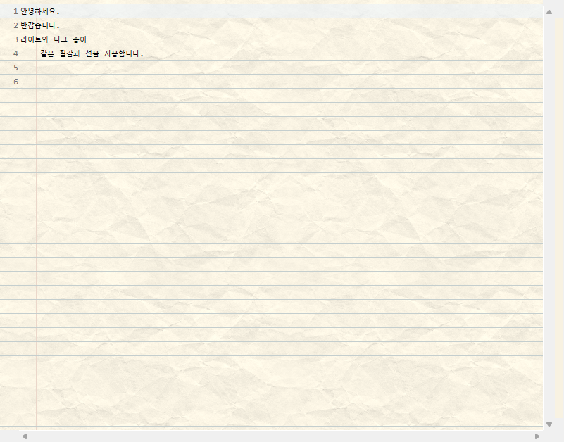
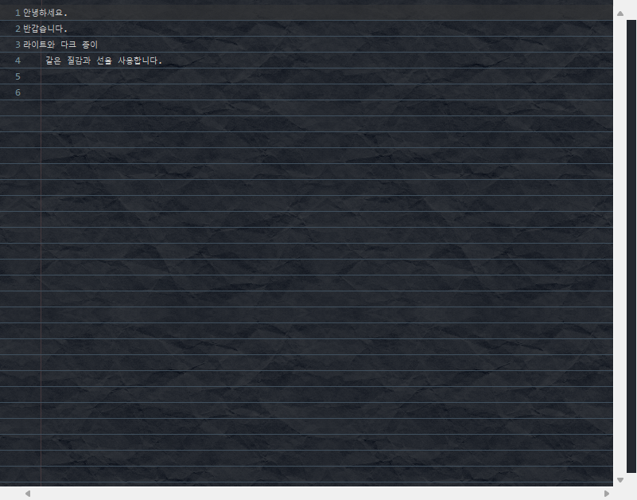

# Paper 사용 매뉴얼

Paper **1.3.12**는 스크롤 중 본문과 줄 번호의 가로줄이 어긋나는 문제를 수정하고, 이미지 변환과 버퍼 생성을 줄였습니다. 줄 번호·접기 영역에도 종이 배경을 연결하며, 오류 표시와 접기 기능은 유지합니다.

## 설치

### ZIP 파일

1. **Help → Install New Software… → Add… → Archive…**를 엽니다.
2. 다운로드한 `paper-update-site-1.3.12.zip`을 선택합니다.
3. **Paper**를 설치하고 IDE를 재시작합니다.

### 업데이트 사이트

1. **Help → Install New Software… → Add…**를 엽니다.
2. Name에 `Paper`, Location에 다음 주소를 입력합니다.
3. 목록에서 **Paper**를 선택해 설치하고 IDE를 재시작합니다.

```text
https://pinnpublic.github.io/eclipse-paper/updates/
```

Paper만 설치·업데이트하려면 설치 화면의 **Contact all update sites during install to find required software**를 해제합니다. 관련 없는 IDE 구성요소가 함께 업데이트되는 것을 피할 수 있습니다.

## 설정 화면

**Window → Preferences → General → Editors → Text Editors → Paper / 노트 배경**

Preferences 검색창에서 `Paper` 또는 `노트`로 검색할 수 있습니다.

1. **소스 편집기에 노트 표시**를 켭니다.
2. **선** 탭에서 선 종류·색상·간격을 설정합니다.
3. **배경** 탭에서 배경 종류·종이색·질감을 설정합니다.
4. 미리보기에서 확인하고 **Apply** 또는 **Apply and Close**를 누릅니다.

 

## 선 설정

| 옵션 | 설정 |
|---|---|
| 모든 글줄 아래에 선 표시 | 가로줄 켜기·끄기 |
| 선 종류 | 실선, 가는 점선, 둥근 점선, 짧은 파선, 긴 파선, 일점쇄선, 이점쇄선, 이중선, 삼중선, 물결선 |
| 선 색상 | 가로줄 색상 |
| 두께 | 글자 높이의 1~25% |
| 텍스트와 선 간격 | 글자 높이의 **-50~100%**. 음수는 선을 글자 쪽으로 이동 |
| 추가 줄 간격 | 기존 줄 간격에 글자 높이의 **0~200%** 추가. 기본값 30% |
| 선 진하기 | 1~100% |
| 현재 줄 강조 불투명도 | **0~100%**. 0은 투명, 100은 불투명. 기본값 50% |

선의 위치는 **텍스트와 선 간격**, 글줄 사이의 높이는 **추가 줄 간격**으로 조절합니다. 추가 줄 간격을 0으로 설정하면 편집기 기본 줄 간격을 사용합니다.

## 배경 설정

| 옵션 | 설정 |
|---|---|
| 배경 종류 | 단색, 공책, 모눈, 촘촘한 모눈, 공학용 모눈, 점 격자, 십자 격자, 세로줄, 등각 격자, 마름모 격자, 원고지, 코넬 노트 |
| 편집기 테마의 배경색 사용 | 켜면 테마 배경색 사용, 끄면 직접 지정한 종이색 사용 |
| 종이 배경색 — 라이트 / 다크 | 각 테마의 종이색을 별도로 지정 |
| 무늬 색상 | 격자·점 등 배경 무늬의 색상 |
| 무늬 크기 | 줄 높이의 50~300% |
| 무늬 진하기 | 1~100% |
| 종이 질감 | 아래 목록에서 선택하거나 `없음` 선택 |
| 질감 진하기 | 0~100%. 0은 질감 숨기기 |

### 공책·코넬 세로선

| 배경 | 세로선 위치 |
|---|---|
| 공책 | 탭 1개 위치에서 왼쪽으로 5px |
| 코넬 노트 | 탭 2개 위치에서 왼쪽으로 5px |

편집기의 탭 크기를 바꾸면 세로선 위치도 바뀝니다.

### 라이트·다크 색상

1. **편집기 테마의 배경색 사용**을 끕니다.
2. 라이트 테마와 다크 테마의 종이색을 각각 지정합니다.
3. **Apply**를 누릅니다.

Eclipse 테마를 전환하면 해당 종이색이 적용됩니다. 선·무늬·질감·간격 설정은 두 테마에서 공통으로 사용합니다.

### 종이 질감

| 분류 | 종류 |
|---|---|
| 기본 종이 | 매끈한 백상지, 고운 미색지, 거친 종이, 재생지, 크라프트지, 한지, 수채화지, 린넨지, 양피지, 코튼지, 신문지 |
| 구김·접힘 | 가볍게 구긴 종이, 거칠게 구긴 종이, 펼친 구김 종이, 사등분 접은 종이, 아코디언 접지 |
| 동양·수제 종이 | 화선지, 생화선지, 숙화선지, 닥종이, 운용지, 대나무 종이, 볏짚 종이, 바나나 섬유지, 로크타 수제지 |
| 특수 표면 | 골판지, 엠보싱 종이, 레이드지, 트레이싱지, 감열지, 얼룩진 빈티지 종이, 대리석 마블지, 청색 도화지, 회색 스케치지, 유산지 |

질감을 선택하면 라이트·다크 종이색이 함께 설정됩니다. 색상을 바꾸려면 질감을 먼저 선택한 뒤 종이색을 지정합니다.

## 확대·축소

- **미리보기:** 설정 화면의 **글꼴 확대/축소**에서 배율을 선택합니다.
- **편집기:** Eclipse의 편집기 글꼴 설정 또는 확대·축소 기능을 사용합니다.

선과 무늬는 글자 크기에 맞춰 조절되고, 종이 질감의 크기는 유지됩니다.

## 삭제

1. **Help → About Eclipse IDE** 또는 **About Spring Tools**를 엽니다.
2. **Installation Details → Installed Software**를 엽니다.
3. **Paper → Uninstall**을 선택하고 IDE를 재시작합니다.

## 사용 환경

| 제품 | Eclipse | Java |
|---|---|---|
| Spring Tool Suite 3.9.18 | 4.21 | 11 |
| Eclipse IDE 2026-06 | 4.40 | 21 |
| Eclipse IDE 2026-09 | 4.41 | 21 |
| Spring Tools for Eclipse 5.3.0 | 4.40 | 21 |

운영체제: Windows. 적용 편집기: Java, Text Editor, XML/JSP 소스 페이지.

---

버전 **1.3.12** · [MIT License](LICENSE) · [변경 내역](CHANGELOG.md) · [문의](https://github.com/pinnpublic/eclipse-paper/issues)

[빌드·검사](DEVELOPMENT.md) · [Marketplace 등록](MARKETPLACE.md)
